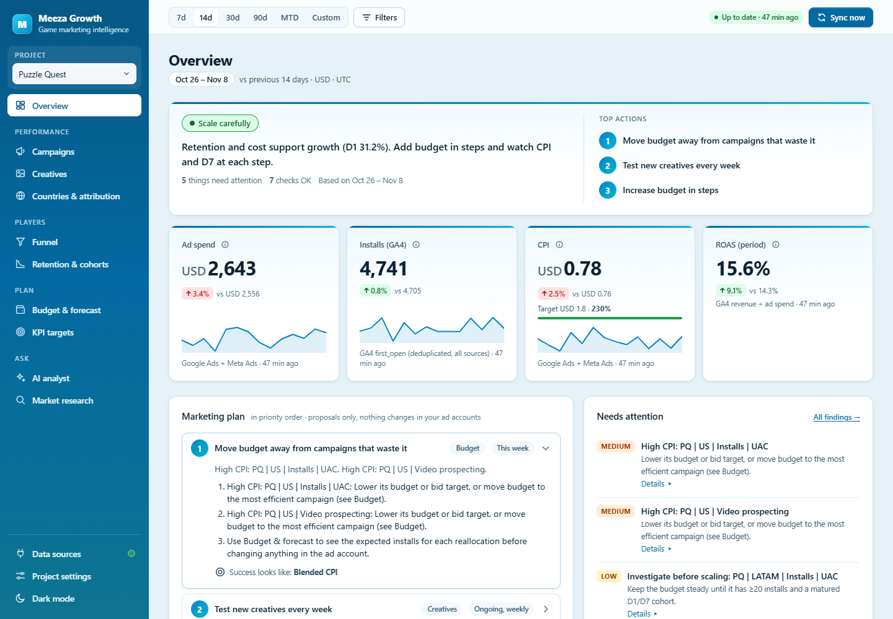

# Meeza Marketing MCP

A read-only [Model Context Protocol](https://modelcontextprotocol.io) server that connects **Meta Ads**, **Google Ads**, **Google Play Console**, **Google Analytics 4 / Firebase** and **Adjust** to Claude. You can then ask questions about ad spend, acquisition costs, countries and app quality in plain language, without opening each dashboard.

The server isn't tied to any game, company or ad account. Each user runs it on their own machine with their own credentials.

- **Read-only on your ad accounts.** The server can't create, edit, pause or delete campaigns, and it never posts review replies. See [Security](#security).
- **Local dashboard.** When Claude connects, a private local dashboard starts at `http://127.0.0.1:5057`. Ask Claude to *"open the marketing dashboard"*, or run `meeza-marketing-mcp dashboard`. Try it with invented sample data and no accounts: `meeza-marketing-mcp dashboard --demo`. See [Dashboard](#dashboard).
- **One project per game.** The dashboard is a multi-project app that keeps a synchronized local history for each game. See [docs/platform.md](docs/platform.md).

## What you need

- **.NET 9 SDK** or newer. The project targets `net9.0`; see [Changing the target framework](#changing-the-target-framework).
- **Claude Code or Claude Desktop.**
- **Credentials for at least one platform you use:** Meta Ads, Google Ads, Google Play Console, Google Analytics 4 / Firebase or Adjust.
- **Windows, if you want the app to store your credentials.** The encrypted store uses Windows DPAPI. On macOS and Linux it isn't available yet, so you supply credentials as environment variables.

## Quick start

1. **Clone and publish.**

   ```powershell
   git clone https://github.com/azeemullah67/meeza-marketing-mcp.git
   cd meeza-marketing-mcp
   dotnet publish src/Meeza.MarketingMcp -c Release -o publish
   ```

   The executable is `publish/meeza-marketing-mcp.exe` (on macOS and Linux it's `publish/meeza-marketing-mcp`).

2. **Add credentials for at least one platform.** Each guide explains what to create and which settings to fill in:
   [Meta Ads](docs/meta-setup.md), [Google Ads](docs/google-ads-setup.md), [Google Play Console](docs/play-console-setup.md), [Google Analytics 4 / Firebase](docs/analytics-setup.md), [Adjust](docs/adjust-setup.md).

   Then store the values in one of two ways.

   **Option A: the dashboard.** Start it, open **Data sources** and fill in the **Credentials** card for the platform. **Save** stores the values and tests the connection.

   ```powershell
   ./publish/meeza-marketing-mcp dashboard
   ```

   **Option B: the terminal.**

   ```powershell
   ./publish/meeza-marketing-mcp secrets set META_ACCESS_TOKEN
   ./publish/meeza-marketing-mcp secrets list
   ```

   Both options write to the encrypted store, which is available on Windows only (DPAPI, scoped to the current user). On macOS and Linux, set the same names as environment variables instead. See [Configuration](#configuration).

3. **Check your setup.** This tests each platform connection and lists the accounts it can see.

   ```powershell
   ./publish/meeza-marketing-mcp check
   ```

4. **Connect Claude.** For Claude Code, use the full path to the published executable:

   ```powershell
   claude mcp add meeza-marketing -- "C:\path\to\publish\meeza-marketing-mcp.exe"
   ```

   For Claude Desktop, follow [docs/claude-setup.md](docs/claude-setup.md). Then ask: *"Which marketing accounts are connected?"*

If something doesn't work, see [docs/troubleshooting.md](docs/troubleshooting.md).

## Dashboard



*Overview page with invented demo data: plan verdict, top actions, KPI tiles against targets, prioritised marketing plan and findings. See [docs/dashboard.md](docs/dashboard.md) for the retention and cohort views.*

Create a project per game and link its Google Ads / Meta / GA4 accounts. The dashboard then keeps a synchronized local history (backfill + hourly incremental sync with freshness tracking).

Pages: executive KPIs with targets, acquisition and attribution reconciliation, D0–D30 cohort retention, campaigns, creative intelligence, funnel, budget forecasting, an AI analyst and cited market research. See [docs/platform.md](docs/platform.md).

Demo mode (`dashboard --demo`) shows one invented project on a temporary database. It reads no credentials and contacts no account, and it can't save credentials or start a sync.

## What you can ask

- "Analyze my advertising campaigns for the last seven days."
- "Compare Pakistan, Philippines and the United States based on CPI."
- "Which campaigns are spending money without generating installs?"
- "What needs my attention in marketing this week?" / "Compare this week with last week."
- "Show my top 10 ads by spend this week with CPI." / "Open the marketing dashboard."
- "Compare Meta Ads and Google Ads acquisition performance for last month."
- "Are crash or ANR rates above Google Play's bad-behavior thresholds?"
- "Summarize this week's 1–2 star reviews and group them by theme."
- "How does my CPI and CTR compare with industry benchmarks for puzzle games?"
- "Can this game work?" / "What is my D1 and D7 retention?"
- "Why does Google Analytics show fewer users than my installs?"

See [examples/prompts.md](examples/prompts.md) for more.

## Tools

Every tool returns the same envelope: `{ tool, ok, dateRange, data, errors[], notes[] }`. If one platform fails, the others still return data.

<details>
<summary>Tool list by area</summary>

| Area | Tools |
|---|---|
| Dashboard | `open_dashboard`, `get_ad_performance` (by ad / ad set / campaign across platforms) |
| Insights | `compare_periods` (this period vs the previous one), `get_marketing_alerts` (spend without installs, CPI outliers, CPI and spend swings, daily anomalies), `get_creative_test_board` (every ad sorted into test / scale / steady / refresh / cut, studio-style) |
| Benchmarks | `get_industry_benchmarks`: sourced mobile-game CPI, CTR, CPM, IPM, retention, ROAS, channel mix and big-studio practices |
| Unified | `get_connected_accounts`, `get_campaign_summary`, `get_spend_summary`, `get_install_summary`, `get_country_comparison`, `get_cpi_comparison`, `get_date_range_report` |
| Meta Ads | `meta_get_ad_accounts`, `meta_get_campaigns`, `meta_get_adsets`, `meta_get_ads`, `meta_get_ad_insights`, `meta_get_country_performance`, `meta_get_cost_per_install` |
| Google Ads | `google_ads_get_accounts`, `google_ads_get_campaigns`, `google_ads_get_performance`, `google_ads_get_conversion_metrics`, `google_ads_get_country_performance`, `google_ads_get_cost_per_install`, `google_ads_get_asset_performance` (each headline, image and video with Google's Low / Good / Best rating) |
| Growth | `get_game_scorecard` (retention graded vs industry, verdict, next steps, estimated LTV vs CPI), `check_analytics_tracking` (GA4 users vs ad installs, diagnosis) |
| Google Analytics 4 / Firebase | `ga4_get_properties`, `ga4_get_active_users`, `ga4_get_retention`, `ga4_get_revenue` ([setup](docs/analytics-setup.md)) |
| Adjust (MMP) | `adjust_list_apps`, `adjust_get_performance` (installs, cost, CPI, revenue by network / campaign / ad group / creative / country), `adjust_get_retention` (install-cohort retention per network, campaign or creative) ([setup](docs/adjust-setup.md)) |
| Google Play | `play_get_app_details`, `play_get_reviews`, `play_get_ratings`, `play_get_android_vitals`, `play_get_crash_metrics`, `play_get_anr_metrics`, `play_get_store_installs` |

</details>

### Data rules

- **Currencies are never converted or mixed.** Totals are always grouped by currency.
- **`null` means unavailable, not zero.** CPI is only computed when installs are greater than 0.
- **Install sources are kept separate.** Meta- and Google-attributed installs can overlap. Play Console installs are store-reported (organic + paid). Adjust installs are deduplicated by Adjust. They are shown side by side and never summed.
- **Adjust cost is never added to ad-platform spend.** It is the same money seen through Adjust, and is the only amount converted (by Adjust, into `ADJUST_CURRENCY`).
- **Time zones.** Each platform reports in its own account time zone. Play vitals use America/Los_Angeles.

## Configuration

Settings are resolved in this order:

1. Environment variables
2. The encrypted secret store (`secrets set`)
3. `appsettings.json` (`Settings` section). This step only applies to **non-secret** settings: secrets are ignored if they appear in `appsettings.json`.

<details>
<summary>Settings reference</summary>

| Setting | Secret | Purpose |
|---|---|---|
| `META_ACCESS_TOKEN` | yes | Meta token with `ads_read` |
| `META_APP_SECRET` | yes | Optional: adds `appsecret_proof` to every call |
| `META_AD_ACCOUNT_IDS` | | Optional allow-list, e.g. `act_123,act_456` |
| `META_API_VERSION` | | Default `v25.0` |
| `GOOGLE_ADS_DEVELOPER_TOKEN` | yes | From the Google Ads API Center |
| `GOOGLE_ADS_CLIENT_ID` | | OAuth Desktop client ID |
| `GOOGLE_ADS_CLIENT_SECRET` | yes | OAuth client secret |
| `GOOGLE_ADS_REFRESH_TOKEN` | yes | Created by `auth google-ads` |
| `GOOGLE_ADS_LOGIN_CUSTOMER_ID` | | Manager (MCC) ID, when access goes through a manager |
| `GOOGLE_ADS_CUSTOMER_IDS` | | Optional allow-list |
| `GOOGLE_ADS_API_VERSION` | | Default `v25` |
| `PLAY_SERVICE_ACCOUNT_KEY_PATH` | | Path to the service account JSON key |
| `PLAY_SERVICE_ACCOUNT_JSON` | yes | Alternative: the key stored in the secret store |
| `PLAY_PACKAGE_NAMES` | | Allow-list, e.g. `com.example.game` |
| `PLAY_REPORTS_BUCKET` | | `pubsite_prod_rev_…` bucket for store installs and ratings exports |
| `ADJUST_API_TOKEN` | yes | Adjust API token (Account settings → My profile) |
| `ADJUST_APP_TOKENS` | | Optional allow-list of Adjust app tokens |
| `ADJUST_CURRENCY` | | Currency Adjust reports cost and revenue in (default `USD`) |
| `MEEZA_DASHBOARD` | | `off` stops the dashboard from starting with the MCP server |
| `MEEZA_DASHBOARD_PORT` | | Dashboard port (default `5057`) |

</details>

On macOS and Linux the encrypted store isn't available yet. Supply secrets as environment variables there, for example from your OS keychain or a secrets manager. The server refuses to write secrets to disk unencrypted.

## Security

To report a vulnerability, use GitHub private vulnerability reporting (Security tab → **Report a vulnerability**). See [SECURITY.md](SECURITY.md).

### Read-only

- Only read endpoints are implemented against Meta, Google and Play. There's no mutate, edit or reply code path.
- Every tool except `sync_project_data` is marked read-only (`readOnlyHint: true`), and a test checks those annotations. `sync_project_data` isn't marked read-only because it refreshes the local copy of a project's data: it reads from the platforms and writes only to the local database.

### Credentials

- Secrets never come from `appsettings.json`.
- Secrets are never written into URLs. Meta and Google tokens travel in the `Authorization` header.
- Each platform has its own `HttpClient` and its own credentials.
- Optional allow-lists restrict which ad accounts and apps can be queried. Account access is validated before every request.

### Logs and errors

- All error text passes through a redactor that strips tokens, `client_secret` values and private keys.
- Logs go to stderr. HTTP client request logging is turned off; a retry warning logs the request URL without its query string.
- Throttling is handled: 429 and 5xx responses are retried with exponential backoff and `Retry-After`, and Meta rate-limit error codes are recognised.

### Dashboard writes

- The dashboard accepts writes (connection settings, projects, KPI targets, task status, sync and AI requests) only as a POST to `/api/settings` or `/api/v2` with a same-origin `Origin` header, a JSON body (128 KB max), a per-process anti-forgery token and the access-key cookie.
- Connection settings are saved to the encrypted local store. Secret values are never sent back to the browser.
- A project can only link accounts inside the configured allow-lists; anything else is refused when it is saved and again before it is synced.

### AI features

- The AI analyst is available as soon as the Claude Code app is installed on this computer (found on `PATH` or in `~/.local/bin`; on Windows only the native `claude.exe`), or when you save your own Anthropic API key in the dashboard or set `ANTHROPIC_API_KEY`. With the app it uses your own Claude sign-in and needs no API key. Choose the engine, or turn the app off by choosing `api`, in **Data sources → Claude → Engine**.
- It runs only when you ask a question in the dashboard. Each question sends your question, the project profile and that project's synced advertising and analytics figures (through the app: the last 14 days plus a forecast from the last 28; on the API: whatever the analyst reads through its tools) to Claude. Nothing is sent in the background.
- Market research needs the API key and runs only when you start a report; it also uses the API's web search. See [docs/security.md](docs/security.md#ai-features).

### Known limitations

The dashboard's Content-Security-Policy still allows inline scripts, and the encrypted secret store works on Windows only (use environment variables elsewhere). See [docs/security.md](docs/security.md#known-limitations) for these and the other known limitations.

## Agent skill (optional)

[`skills/meeza-marketing/SKILL.md`](skills/meeza-marketing/SKILL.md) tells the agent when to reach for which tool, how to read attribution and retention correctly, and how to answer a marketer. For Claude Code copy the folder to `.claude/skills/meeza-marketing/` (project) or `~/.claude/skills/meeza-marketing/` (user); other agents that read `SKILL.md` files work the same way.

## Repository layout

```text
src/
  Meeza.MarketingMcp/          MCP host, CLI commands, unified and project tools
    Dashboard/                 Local dashboard: web server, /api/v2, single-page app (app.html), demo mode
    Storage/ Sync/ Intelligence/  Local project store, background sync, analysis and checks
    Ai/                        AI analyst (Claude app or API) and market research
  Meeza.Marketing.Shared/      Normalized models, metrics, secrets, HTTP retry, redaction
  Meeza.Marketing.Meta/        Meta Marketing API client and tools
  Meeza.Marketing.GoogleAds/   Google Ads API (REST + GAQL) client and tools
  Meeza.Marketing.PlayConsole/ Play Developer Reporting API, reviews, bulk-report exports
  Meeza.Marketing.Analytics/   Google Analytics 4 / Firebase Data API client and tools
  Meeza.Marketing.Adjust/      Adjust reporting API client and tools
tests/Meeza.Marketing.Tests/   Unit tests (no network)
tests/Meeza.Marketing.FakeClaude/  Stand-in for the Claude Code executable, used by the tests
skills/meeza-marketing/        SKILL.md: when and how an agent should use these tools
docs/                          Setup guides, architecture, security, troubleshooting
examples/                      Claude config and example prompts
```

See [docs/architecture.md](docs/architecture.md) for the design.

## Development

```powershell
dotnet test
```

See [CONTRIBUTING.md](CONTRIBUTING.md) for the ground rules.

## Changing the target framework

The target framework is set in one place, [Directory.Build.props](Directory.Build.props) (`MeezaTargetFramework`). Once the .NET 10 SDK is installed, set it to `net10.0`.

## Roadmap

See [docs/roadmap.md](docs/roadmap.md) for the full UA gap analysis (MMP, cohort ROAS, ad revenue, SKAN, more networks, creative analytics). Highlights:

- GA4 funnels and events (active users, cohort retention, level progression and revenue are already in).
- Encrypted secret store for macOS Keychain and Linux libsecret.
- Hosted multi-tenant version (Streamable HTTP, OAuth account linking, tenant isolation).

## License

[MIT](LICENSE) © Meeza Technologies. You are responsible for your own Meta and Google developer access, API permissions, and compliance with each platform's policies.
