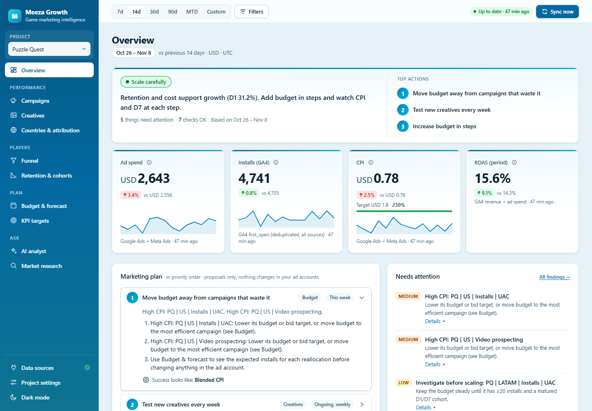
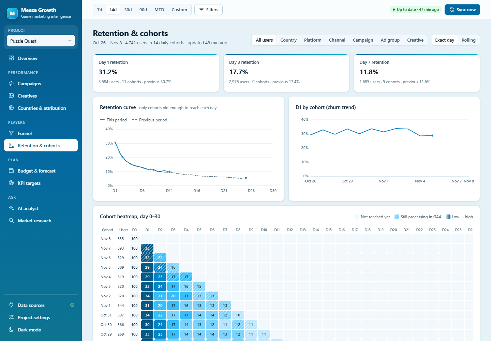

# Live dashboard

The server includes a local, read-only web dashboard. It uses the same platform connections as the MCP tools.

*Overview: verdict, top actions, KPI tiles vs targets, prioritised marketing plan, findings that need attention.*

*Retention & cohorts: D1/D3/D7 against the previous period, retention curve, D1 churn trend and the day 0–30 cohort heatmap, segmentable by country, platform, channel, campaign, ad group or creative.*

Both screenshots use an invented "Puzzle Quest" project, not real accounts.

## Opening it

| How | What happens |
|---|---|
| Ask Claude: *"open the marketing dashboard"* | Claude calls `open_dashboard`, which opens your browser and returns the link |
| `meeza-marketing-mcp dashboard` | Starts the dashboard (or reuses a running one) and opens your browser |
| `meeza-marketing-mcp dashboard --demo` | Preview with generated sample data. No accounts are contacted. |
| `--no-browser` | Prints the link without opening a browser |

The dashboard starts automatically whenever Claude launches the MCP server. To turn that off, set `MEEZA_DASHBOARD=off` in the server's environment. The default address is `http://127.0.0.1:5057`; change the port with `MEEZA_DASHBOARD_PORT`.

## Settings (connections)

Click **⚙ Settings** in the header, or open the link in the connection popover. Each connection (Meta Ads, Google Ads, Google Play Console) has a card with:

- **Setup steps:** numbered instructions with links to the exact console pages.
- **Fields:** paste tokens and IDs. Secrets are password fields; once saved they show **✓ saved** and are never displayed or sent back to the browser. For Google Play, choose the downloaded JSON key file; it's read locally and stored encrypted. The service account email to invite in Play Console is then shown.
- **Save:** validates the input (account IDs, package names, bucket, JSON key), stores it in the encrypted store (`%APPDATA%\MeezaMarketingMcp\secrets.json`, DPAPI), applies it immediately without a restart, and tests the connection.
- **Test connection:** lists the accounts or apps it can see, or the exact error.
- **Sign in with Google** (Google Ads): opens Google's consent page and stores the refresh token.
- **Disconnect:** removes that connection's saved values.

Values set as environment variables take priority and are shown as locked. In demo mode, **Show my live data** switches the dashboard to your real accounts.

## What it shows

- **Status:** one connection indicator (click it for each platform's state), the time of the last refresh, and the period being compared ("Oct 28 – Nov 3 vs Oct 21 – 27"). Auto-refresh can be off, or every 1, 5 or 15 minutes.
- **Section bar:** jump to Overview, Performance, Benchmarks, Countries or Google Play. The current section is highlighted.
- **Top strip.** It has three cards:
  - **Growth health:** a 0–100 checklist score made of spend efficiency, creative pipeline, install tracking and app quality. Hover any bar to see exactly how it's scored.
  - **What's going on:** spend, installs, best ad, creative pipeline, top market and app health, each shown as an icon tile.
  - **Improve next:** a ranked action list. Examples: FIX vitals or rating, CUT losing ads (with the money it saves), CHECK a CPI jump, SCALE the best ad, REFRESH tired creatives, TEST new formats (playable, creator/UGC) and TRACK installs. Each action jumps to the rows behind it.
- **Creative testing lab:** the test-and-scale loop large studios run, as a board with the columns Testing → Scale → Steady → Refresh → Cut.
  - **Each ad card:** a format icon (▶ video, ◆ playable, ☺ creator/UGC, ▣ static), CPI, spend, an IPM bar and Meta frequency.
  - **The spend bar** shows how much budget sits in each stage.
  - **"How ads are sorted"** lists the rules: each ad is compared with its own platform's median CPI; winners are at or below 0.8× it, losers at or above 1.5×, and refresh means a frequency of 3.5 or more.
- **Filters:** date range (yesterday, 7/14/30/90 days, this month, last month, custom), platform, and currency.
- **KPI tiles:** spend, installs, CPI and IPM first, then CTR, CPC, CPM, impressions and clicks. Each shows the change against the previous period of the same length. Green means better and red means worse, so a rising CPI is red. Hover a change to see the previous value. Installs, CPI and IPM are shown per platform only. They are never added together, because Meta and Google Ads attribute installs independently and can both claim the same install.
- **Daily charts:** spend per day and attributed installs per day for each platform, with hover tooltips and a table view.
- **Performance by ad:** every ad across Meta and Google Ads, which you can switch to ad sets / ad groups or campaigns. Columns: status, spend, share of spend, impressions, clicks, CTR, CPC, CPM, installs and CPI. Active rows show their status as plain text, so paused rows and problems stand out. A CPI over 2× the median is marked in red, and the lowest-CPI row with 10+ installs gets a "Best CPI" tag. Rows are sortable and searchable, can be filtered by status, and have a **Spending without installs** filter. Export to CSV is available.
- **How you compare with the industry:** your CPI, CPM, CPC, CTR, IPM and click-to-install rate per platform against published mobile-game benchmarks (Adjust, Liftoff, AppsFlyer, Sensor Tower, GameAnalytics, Google, AppTweak), filtered by genre and OS. Tabs show CPI by country against regional benchmarks; retention, ROAS, store-quality and channel-mix benchmarks; a playbook of documented practices from large studios (Supercell, Dream Games, Scopely, Habby, King); and the full source list. Every figure links to its source and period. Countries without a verified public benchmark (for example Pakistan, the Philippines and India) show none rather than a guess. Benchmarks are USD, so money metrics are compared only when the selected currency is USD. The data is a dated snapshot in `src/Meeza.MarketingMcp/Benchmarks/benchmarks.json`; update that file to refresh it.
- **Countries:** spend, CTR, installs and CPI per platform, grouped by country.
- **Google Play:** user-perceived crash and ANR rates against Google's bad-behaviour thresholds (with daily sparklines), store installs from the Play Console exports, and recent reviews with their star distribution.

Totals are always for a single currency. If your accounts use several currencies, choose one with the currency selector.

## How fresh is the data?

- Each view is cached for **3 minutes** to stay within API rate limits. **Refresh** always fetches fresh data.
- Today's numbers are incomplete on every platform.
- Android vitals lag by 1–2 days, and Play Console export reports lag by a few days.

## Security

- The dashboard listens on **127.0.0.1 only**, so it can't be reached from your network.
- Every request needs a private access key. The key is in the link that Claude or the CLI gives you. After the first visit it's stored as an `HttpOnly`, `SameSite=Strict` cookie, and the URL is cleaned.
- The key is kept in `%APPDATA%\MeezaMarketingMcp\dashboard.key` (on macOS/Linux, `~/.config/MeezaMarketingMcp/dashboard.key`), readable by your user only. Run `meeza-marketing-mcp dashboard rotate-key` (or delete that file) to revoke every existing link and browser session; running instances notice on their next request, no restart needed.
- When the dashboard port is already taken, the CLI and the `open_dashboard` tool first check that the listener really is your Meeza dashboard (a challenge only the running instance can answer). Another program on that port gets no link; the message tells you to set `MEEZA_DASHBOARD_PORT`. See [security.md](security.md).
- Requests with a foreign `Host` header are rejected, which blocks DNS-rebinding attacks.
- Only `GET` requests are accepted. A strict Content-Security-Policy blocks external scripts, and the page loads no third-party code.
- Ad names and review text are HTML-escaped before display. CSV export neutralises spreadsheet formulas.
